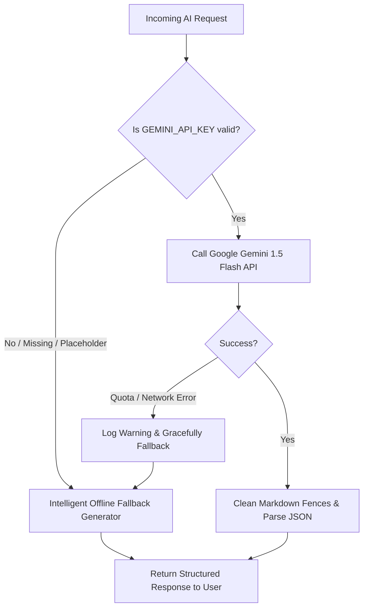

# 🚀 CareerAI — AI-Powered Career Enhancement System

[](https://react.dev/)
[](https://aistudio.google.com/)
[](LICENSE)

An intelligent, full-stack career acceleration and interview preparation platform built with **React 19, Node.js, Express, MongoDB Atlas, and Google Gemini AI**. 

CareerAI empowers students and job seekers with end-to-end career guidance—from setting career goals, discovering skill gaps, and generating structured learning roadmaps, to crafting ATS-optimized resumes, practicing role-specific AI mock interviews, and managing job applications in a single pipeline.

---

## 📑 Table of Contents

- [Overview & Value Proposition](#-overview--value-proposition)
- [System Architecture](#-system-architecture)
- [Project Directory Structure](#-project-directory-structure)
- [Core Features & Modules](#-core-features--modules)
- [AI Engine & Offline Fallback Architecture](#-ai-engine--offline-fallback-architecture)
- [API Endpoints Reference](#-api-endpoints-reference)
- [Database Schema & Data Models](#-database-schema--data-models)
- [Tech Stack](#-tech-stack)
- [Local Development Setup](#-local-development-setup)
- [Default Demo Accounts](#-default-demo-accounts)
- [Production Deployment Guide (Vercel + Render)](#-production-deployment-guide-vercel--render)
- [Environment Variables Specification](#-environment-variables-specification)

---

## 💡 Overview & Value Proposition

Traditional job hunting is fragmented: job seekers use separate tools for resume writing, learning pathways, interview preparation, and application tracking. **CareerAI consolidates the entire career journey into a unified, AI-assisted platform**:

1. **Targeted Career Direction**: Identifies industry demand, expected salary ranges, and matching scores for 16+ tech career paths.
2. **Actionable Skill Gap Analysis**: Compares a user's current skillset against their target job profile to pinpoint missing competencies and estimate learning timelines.
3. **Phased Learning Roadmaps**: Automatically builds structured multi-week learning roadmaps equipped with real curated learning resources (tutorials, documentation, courses, exercises) and progress tracking.
4. **Smart Resume Suite**: Multi-section resume builder with instant AI feedback covering ATS keyword optimization, strengths, weaknesses, and scoring.
5. **Interactive AI Mock Interviews**: Dynamically generates tailored behavioral and technical questions based on chosen role and difficulty, grading user responses with qualitative feedback and numeric scores.
6. **Kanban-Style Job Tracker**: Tracks job application pipelines (Applied, Screening, Interview, Offer, Rejected, Withdrawn) with timeline milestones and note-taking.
7. **Administrative Analytics**: Centralized administrative dashboard tracking platform health, candidate registrations, and hiring funnel metrics.

---

## 🏛️ System Architecture

```mermaid
graph TD
    User["👤 Student / Job Seeker"] -->|Browser HTTPS| Client["Frontend Client (React 19 + Vite)"]
    Admin["🛡️ Platform Admin"] -->|Browser HTTPS| Client

    subgraph Frontend ["Client Layer (Hosted on Vercel)"]
        Client --> Router["React Router v7"]
        Router --> Context["Auth Context (JWT + LocalStorage)"]
        Router --> AxiosService["Axios API Client (/api)"]
    end

    AxiosService -->|REST API Requests| Backend["Express.js Server (Hosted on Render)"]

    subgraph Backend ["Server & AI Layer"]
        Backend --> CORS["CORS & Auth Middleware (JWT Verify)"]
        CORS --> Controllers["Express Controllers"]
        
        Controllers --> DB["Database Layer"]
        Controllers --> AIEngine["AI Service (utils/geminiClient.js)"]
        
        AIEngine -->|Live Inference| Gemini["Google Gemini 1.5 Flash API"]
        AIEngine -->|Zero-Crash Fallback| Fallback["Contextual Offline AI Generator"]
    end

    subgraph Storage ["Data Persistence Layer"]
        DB --> MongoAtlas["MongoDB Atlas Cluster (Primary)"]
        DB -.->|Local Dev Fallback| MongoMemory["MongoMemoryServer (In-Memory)"]
    end
```

---

## 📂 Project Directory Structure

```text
Career Enhancement System/
├── backend/                             # Express.js REST API server
│   ├── config/
│   │   └── db.js                        # MongoDB Atlas connection & in-memory fallback
│   ├── controllers/
│   │   ├── authController.js            # User registration, login, profile management
│   │   ├── careerController.js          # AI career advisory, chatbot, roadmap, skill gaps
│   │   ├── interviewController.js       # AI question generation, answer scoring
│   │   ├── jobController.js             # Job application CRUD & admin analytics
│   │   └── resumeController.js          # Resume builder persistence & AI ATS review
│   ├── middleware/
│   │   └── authMiddleware.js            # JWT verification & role-based access guard
│   ├── models/
│   │   ├── Interview.js                 # Mock interview session schema
│   │   ├── JobApplication.js            # Job pipeline tracking schema
│   │   ├── LearningRoadmap.js           # Multi-phase roadmap schema
│   │   ├── Resume.js                    # Comprehensive resume document schema
│   │   └── User.js                      # User credentials, profile, & role schema
│   ├── routes/
│   │   ├── authRoutes.js                # /api/auth routes
│   │   ├── careerRoutes.js              # /api/career routes
│   │   ├── interviewRoutes.js           # /api/interview routes
│   │   ├── jobRoutes.js                 # /api/jobs routes
│   │   └── resumeRoutes.js              # /api/resume routes
│   ├── uploads/                         # Storage directory for uploaded resumes
│   │   └── .gitkeep
│   ├── utils/
│   │   ├── geminiClient.js              # Google Gemini AI wrapper with offline fallback
│   │   └── generateToken.js             # JWT signer helper
│   ├── .env                             # Local secrets (ignored by Git)
│   ├── .env.example                     # Environment reference template for Render
│   ├── package.json
│   └── server.js                        # Main Express entry point with CORS & 0.0.0.0 binding
│
├── frontend/                            # React 19 + Vite SPA
│   ├── public/                          # Static assets and icons
│   ├── src/
│   │   ├── assets/                      # Application graphic assets
│   │   ├── components/layout/           # Sidebar navigation, topbars, responsive shell
│   │   ├── context/
│   │   │   └── AuthContext.jsx          # Global auth provider and session verification
│   │   ├── pages/
│   │   │   ├── admin/
│   │   │   │   └── AdminDashboard.jsx   # Metrics, charts, user registration timeline
│   │   │   ├── auth/
│   │   │   │   ├── Login.jsx            # Student / Admin authentication
│   │   │   │   ├── Register.jsx         # New student sign-up
│   │   │   │   └── Profile.jsx          # Skills, career goal, and bio manager
│   │   │   ├── career/
│   │   │   │   ├── CareerChatbot.jsx    # Conversational CareerBot assistant
│   │   │   │   ├── CareerGoals.jsx      # 16-path goal selector
│   │   │   │   ├── CareerRecommendations.jsx # Profile-matched career paths & salaries
│   │   │   │   ├── LearningRoadmap.jsx  # Interactive roadmap with topic checklist
│   │   │   │   └── SkillGap.jsx         # Missing skills analysis & readiness scores
│   │   │   ├── interview/
│   │   │   │   ├── MockInterview.jsx    # Role & difficulty interview creator
│   │   │   │   └── InterviewSession.jsx # Interactive Q&A and AI score feedback
│   │   │   ├── jobs/
│   │   │   │   └── JobTracker.jsx       # Job pipeline tracker modal & status filter
│   │   │   ├── resume/
│   │   │   │   ├── ResumeBuilder.jsx    # 7-section professional resume editor
│   │   │   │   └── ResumeUpload.jsx     # Document uploader & AI scoring review
│   │   │   ├── Dashboard.jsx            # Unified user home with summary widgets
│   │   │   └── Dashboard.css
│   │   ├── services/
│   │   │   └── api.js                   # Central Axios client with token interceptor
│   │   ├── App.jsx                      # Protected route rules & toast configurations
│   │   ├── index.css                    # Custom dark glassmorphic design system
│   │   └── main.jsx                     # Vite React DOM entry
│   ├── eslint.config.js                 # Linter configuration (0 errors clean)
│   ├── index.html                       # HTML5 metadata & root container
│   ├── package.json
│   ├── vercel.json                      # Single Page App routing rewrites
│   ├── vite.config.js                   # Vite dev server and proxy definitions
│   └── .env.example                     # Environment reference template for Vercel
│
├── render.yaml                          # Infrastructure Blueprint for 1-click Render deployment
├── .gitignore                           # Git ignore rules for node_modules, .env, dist
├── package.json                         # Root convenience scripts (dev:backend, dev:frontend)
└── README.md                            # Comprehensive project documentation
```

---

## 🎯 Core Features & Modules

### 1. 🔐 User Authentication & Role-Based Access Control
- **Secure Authentication**: Password hashing using `bcryptjs` and stateless session management with standard JSON Web Tokens (JWT).
- **Profile Customization**: Students manage personal contact details, bio, technical skill tags, and target career goals.
- **RBAC Guards**: Protected routes on both client and API levels separating student actions from administrative functions.

### 2. 🤖 AI Career Guidance Suite
- **16 Curated Career Paths**: Quick-select presets including Full Stack Developer, Data Scientist, DevOps Engineer, Cloud Architect, AI/ML Specialist, and UX Designer.
- **Personalized Recommendations**: Evaluates education background, current skills, and target goal to return salary ranges, market demand, and key requirements.
- **Conversational CareerBot**: Context-aware AI chatbot loaded with the student's name, goal, and skillset to answer career progression, interview prep, and salary negotiation questions.

### 3. 🗺️ Skill Gap Analysis & Learning Roadmaps
- **Gap Identification**: Analyzes missing skills against industry expectations, categorizing them by priority (*Critical*, *Important*, *Nice-to-have*) with estimated study times.
- **Phased Roadmaps**: Generates custom 3-4 phase learning plans containing specific subtopics and external resources (documentation, courses, interactive exercises).
- **Progress Tracking**: Interactive checkboxes automatically recalculate completion percentage in real time and sync with the database.

### 4. 📄 Resume Builder & AI ATS Evaluation
- **7-Section Builder**: Dedicated interactive forms for Personal Info, Professional Summary, Education, Work Experience, Technical Skills, Projects, and Certifications.
- **Document Uploader**: Drag-and-drop file upload supporting PDF, DOC, and DOCX formats via Multer.
- **AI Resume Review**: Gemini evaluates resume data across 4 dimensions: Overall Score (0-100), Strengths, Weaknesses, Actionable Improvement Recommendations, and ATS Keyword Extractions.

### 5. 🎤 AI Mock Interviews
- **Customizable Sessions**: Generates role-specific questions across **Easy** (3 questions), **Medium** (5 questions), and **Hard** (7 questions) difficulty tiers.
- **Interactive Interview Session**: Step-through question interface with answer input and status tracking.
- **Per-Answer & Overall Scoring**: Evaluates each response with an individual score (1-10) and feedback tips, culminating in an overall score and executive performance summary.

### 6. 💼 Job Application Tracker
- **Pipeline Stages**: Organize opportunities across `Applied`, `Screening`, `Interview`, `Offer`, `Rejected`, and `Withdrawn`.
- **Application Metadata**: Store company name, job title, location, employment type (Full-time, Internship, Remote, etc.), salary, job posting link, and notes.
- **Status Audit Timeline**: Automatically timestamps every status transition to track application lifecycles.

### 7. 🛡️ Administrative Analytics Dashboard
- **Platform Telemetry**: Aggregates total students, tracked applications, completed interviews, and created resumes.
- **Interactive Visualizations**: Application breakdown charts powered by Recharts (`PieChart`, `Tooltip`).
- **Student Activity Feed**: Displays recently registered students and interview completion rates.

---

## 🧠 AI Engine & Offline Fallback Architecture

The AI module in [`backend/utils/geminiClient.js`](file:///d:/12345/AM/Career%20Enhancement%20System/backend/utils/geminiClient.js) integrates with **Google Gemini 1.5 Flash** with an **Intelligent Graceful Fallback**:



- **Structured Output Compliance**: Requests use strict system prompts ensuring Gemini returns pure JSON objects without conversational prefixes or code fences.
- **Development Resilience**: If an API key is not configured, expired, or hits quota limits, the system does not crash or throw 500 errors. Instead, it serves high-quality contextual simulation data for testing and demonstrations.

---

## 🔌 API Endpoints Reference

All API routes are prefixed with `/api`. Protected routes require a valid `Bearer <token>` in the `Authorization` header.

### 1. Authentication (`/api/auth`)
| Method | Endpoint | Access | Description |
|:---|:---|:---|:---|
| `POST` | `/api/auth/register` | Public | Register a new student account (`name`, `email`, `password`) |
| `POST` | `/api/auth/login` | Public | Authenticate user credentials and return JWT token |
| `GET` | `/api/auth/me` | Protected | Fetch authenticated profile details |
| `PUT` | `/api/auth/profile` | Protected | Update profile, skills, career goal, bio, and password |

### 2. Career Guidance (`/api/career`)
| Method | Endpoint | Access | Description |
|:---|:---|:---|:---|
| `POST` | `/api/career/recommendations` | Protected | Request AI-generated career paths based on profile & skills |
| `POST` | `/api/career/chat` | Protected | Send message to CareerBot with conversation history |
| `POST` | `/api/career/skill-gap` | Protected | Analyze skill deficiencies against target job title |
| `POST` | `/api/career/roadmap` | Protected | Generate structured phased learning plan |
| `GET` | `/api/career/roadmap` | Protected | Retrieve saved learning roadmap for user |
| `PUT` | `/api/career/roadmap/topic` | Protected | Toggle completion status of a roadmap topic |

### 3. Resume Management (`/api/resume`)
| Method | Endpoint | Access | Description |
|:---|:---|:---|:---|
| `GET` | `/api/resume` | Protected | Fetch user's active resume document |
| `PUT` | `/api/resume` | Protected | Save structured resume builder sections |
| `POST` | `/api/resume/upload` | Protected | Upload physical resume document (PDF, DOC, DOCX) |
| `POST` | `/api/resume/analyze` | Protected | Trigger Gemini AI scoring & ATS recommendations |

### 4. AI Mock Interview (`/api/interview`)
| Method | Endpoint | Access | Description |
|:---|:---|:---|:---|
| `POST` | `/api/interview/start` | Protected | Initialize mock interview session with AI questions |
| `GET` | `/api/interview` | Protected | Retrieve user's mock interview history |
| `GET` | `/api/interview/:id` | Protected | Fetch single mock interview session by ID |
| `PUT` | `/api/interview/:id/submit` | Protected | Submit interview answers for AI scoring & feedback |

### 5. Job Applications & Admin (`/api/jobs`)
| Method | Endpoint | Access | Description |
|:---|:---|:---|:---|
| `GET` | `/api/jobs` | Protected | List all tracked jobs for the authenticated user |
| `POST` | `/api/jobs` | Protected | Log a new job application |
| `PUT` | `/api/jobs/:id` | Protected | Update application status, salary, or notes |
| `DELETE` | `/api/jobs/:id` | Protected | Remove a job application record |
| `GET` | `/api/jobs/admin/stats` | Admin Only | Retrieve aggregated platform statistics for dashboard |
| `GET` | `/api/jobs/admin/all` | Admin Only | Retrieve all student applications across the platform |

### 6. System Health
| Method | Endpoint | Access | Description |
|:---|:---|:---|:---|
| `GET` | `/api/health` | Public | Returns `{ status: "OK", message: "..." }` |

---

## 🗄️ Database Schema & Data Models

### 1. `User` Schema
```javascript
{
  name:        { type: String, required: true },
  email:       { type: String, required: true, unique: true },
  password:    { type: String, required: true }, // Hashed via bcryptjs
  role:        { type: String, enum: ['student', 'admin'], default: 'student' },
  avatar:      { type: String, default: '' },
  phone:       { type: String, default: '' },
  bio:         { type: String, default: '' },
  skills:      [{ type: String }],
  careerGoal:  { type: String, default: '' },
  education:   [{ type: Object }],
  experience:  [{ type: Object }]
}
```

### 2. `Resume` Schema
```javascript
{
  user:           { type: ObjectId, ref: 'User', required: true, unique: true },
  personalInfo:   { name, email, phone, address, linkedin, github, portfolio },
  summary:        { type: String, default: '' },
  education:      [{ degree, institution, year, gpa }],
  experience:     [{ role, company, duration, description }],
  skills:         [{ type: String }],
  projects:       [{ title, description, link, techStack: [String] }],
  certifications: [{ name, issuer, year }],
  uploadedFile:   { type: String, default: '' },
  aiAnalysis: {
    score:        { type: Number },
    strengths:    [{ type: String }],
    weaknesses:   [{ type: String }],
    suggestions:  [{ type: String }],
    keywords:     [{ type: String }],
    analyzedAt:   { type: Date }
  }
}
```

### 3. `LearningRoadmap` Schema
```javascript
{
  user:            { type: ObjectId, ref: 'User', required: true, unique: true },
  careerGoal:      { type: String, required: true },
  skillGaps:       [{ type: String }],
  roadmap: [{
    phase:         { type: Number },
    title:         { type: String },
    duration:      { type: String },
    topics: [{
      name:        { type: String },
      completed:   { type: Boolean, default: false },
      completedAt: { type: Date },
      resources:   [{ title: String, url: String, type: String }]
    }]
  }],
  overallProgress: { type: Number, default: 0 },
  generatedAt:     { type: Date, default: Date.now }
}
```

### 4. `Interview` Schema
```javascript
{
  user:            { type: ObjectId, ref: 'User', required: true },
  jobRole:         { type: String, required: true },
  difficulty:      { type: String, enum: ['Easy', 'Medium', 'Hard'], default: 'Medium' },
  questions: [{
    question:      { type: String },
    answer:        { type: String, default: '' },
    feedback:      { type: String, default: '' },
    score:         { type: Number, default: 0 }
  }],
  overallScore:    { type: Number, default: 0 },
  overallFeedback: { type: String, default: '' },
  status:          { type: String, enum: ['in-progress', 'completed'], default: 'in-progress' },
  completedAt:     { type: Date }
}
```

### 5. `JobApplication` Schema
```javascript
{
  user:            { type: ObjectId, ref: 'User', required: true },
  company:         { type: String, required: true },
  position:        { type: String, required: true },
  location:        { type: String },
  jobType:         { type: String, enum: ['Full-time', 'Part-time', 'Internship', 'Contract', 'Remote'], default: 'Full-time' },
  salary:          { type: String },
  status:          { type: String, enum: ['Applied', 'Screening', 'Interview', 'Offer', 'Rejected', 'Withdrawn'], default: 'Applied' },
  jobUrl:          { type: String },
  notes:           { type: String },
  timeline:        [{ status: String, date: { type: Date, default: Date.now }, note: String }],
  appliedDate:     { type: Date, default: Date.now }
}
```

---

## 🛠️ Tech Stack

| Layer | Technology | Purpose |
|:---|:---|:---|
| **Frontend Framework** | React 19 + Vite | High-performance SPA with modern React hooks & fast HMR |
| **Routing** | React Router v7 | Protected client-side routing and layout hierarchies |
| **State & Auth** | React Context API | Global authentication state and token management |
| **HTTP Client** | Axios | REST API integration with automated bearer token interceptor |
| **UI & Styling** | Custom Dark CSS System | Glassmorphism, tailored CSS custom properties, responsive layout |
| **Visualizations** | Recharts | Interactive SVG pie and bar charts for analytics |
| **Icons & Feedback** | Lucide React + React Hot Toast | Modern icon set and non-intrusive toast notification alerts |
| **File Handling** | React Dropzone | Drag-and-drop document upload interface |
| **Backend Runtime** | Node.js + Express.js 5 | Scalable RESTful API backend architecture |
| **Primary Database** | MongoDB Atlas | Cloud-hosted NoSQL document database |
| **Dev Database** | MongoMemoryServer | Automatic zero-configuration in-memory MongoDB for offline development |
| **ODM** | Mongoose 9 | Strict schema definition, validation, and aggregations |
| **AI Inference** | Google Gemini 1.5 Flash | Large Language Model for career suggestions, chat, and grading |
| **File Processing** | Multer | File upload multipart processing with type verification |
| **Security** | JWT + bcryptjs | Secure password hashing and stateless token issuance |

---

## 💻 Local Development Setup

### Prerequisites
- [Node.js](https://nodejs.org/) (version 18 or higher recommended)
- [Git](https://git-scm.com/)
- Optional: MongoDB Atlas cluster URL and Google Gemini API key (the application provides automatic in-memory DB and AI fallback modes if not supplied).

### 1. Clone the Repository
```bash
git clone https://github.com/sanjaykumardk2006/Career-Enhancement-System.git
cd "Career Enhancement System"
```

### 2. Configure Backend Environment
Create or edit `backend/.env`:
```env
PORT=5000
MONGO_URI=mongodb+srv://<username>:<password>@cluster0.pat8nue.mongodb.net/careerAI?retryWrites=true&w=majority
JWT_SECRET=super_secret_jwt_key_here
GEMINI_API_KEY=AIzaSyYourGeminiApiKeyHere
NODE_ENV=development
CLIENT_URL=http://localhost:5173
```
> **Note**: If `MONGO_URI` is left blank or retains the placeholder, the backend will automatically spin up an in-memory database using `mongodb-memory-server`.

### 3. Install Dependencies
You can install dependencies for both services from the root folder:
```bash
npm run install:all
```
*(Or manually run `cd backend && npm install` and `cd ../frontend && npm install`)*

### 4. Run the Development Servers
Open two terminal windows:

**Terminal 1 — Backend API:**
```bash
npm run dev:backend
# API server starts on http://localhost:5000
```

**Terminal 2 — Frontend App:**
```bash
npm run dev:frontend
# Client starts on http://localhost:5173
```

Visit **`http://localhost:5173`** in your browser.

---

## 👥 Default Demo Accounts

When connecting for the first time, default accounts are seeded automatically:

| Role | Email | Password | Access Level |
|:---|:---|:---|:---|
| **Student** | `student@demo.com` | `demo123` | Full access to career tools, resume, interview, & job tracker |
| **Admin** | `admin@demo.com` | `admin123` | Student access + `/admin` analytics dashboard |

*You can also register any new account freely on the `/register` page.*

---

## 🚀 Production Deployment Guide (Vercel + Render)

This codebase is configured for deploying the **frontend to Vercel** and the **backend to Render**.

### 1. Deploy the Backend on Render (Web Service)
1. Sign in to [Render](https://render.com/) and click **New +** → **Web Service**.
2. Connect your GitHub repository: `sanjaykumardk2006/Career-Enhancement-System`.
3. Set the service parameters:
   - **Name**: `career-enhancement-backend`
   - **Root Directory**: `backend`
   - **Environment**: `Node`
   - **Build Command**: `npm install`
   - **Start Command**: `npm start`
4. In the **Environment Variables** section, add:
   - `NODE_ENV` = `production`
   - `PORT` = `5000`
   - `MONGO_URI` = `mongodb+srv://<user>:<password>@cluster0.pat8nue.mongodb.net/careerAI?retryWrites=true&w=majority`
   - `JWT_SECRET` = `<your-secure-random-string>`
   - `GEMINI_API_KEY` = `<your-google-ai-studio-key>`
   - `CLIENT_URL` = `https://<your-vercel-app>.vercel.app` (or `*`)
5. Click **Deploy Web Service** and copy your backend URL (e.g. `https://career-enhancement-backend.onrender.com`).

---

### 2. Deploy the Frontend on Vercel
1. Sign in to [Vercel](https://vercel.com/) and click **Add New...** → **Project**.
2. Select your repository `Career-Enhancement-System`.
3. Configure project settings:
   - **Framework Preset**: `Vite`
   - **Root Directory**: Click *Edit* and select **`frontend`**
   - **Build Command**: `npm run build`
   - **Output Directory**: `dist`
4. In the **Environment Variables** section, add:
   - `VITE_API_URL` = `https://career-enhancement-backend.onrender.com/api`
   *(Ensure `/api` is included at the end of the URL)*
5. Click **Deploy**!
> **Note**: `frontend/vercel.json` already contains single-page application (SPA) rewrites to ensure subroutes (`/dashboard`, `/career/goals`, etc.) never return 404 errors upon browser reload.

---

## ⚙️ Environment Variables Specification

### Backend Variables (`backend/.env`)
| Variable | Required? | Default / Example | Purpose |
|:---|:---:|:---|:---|
| `PORT` | Optional | `5000` | Port on which the Express server listens |
| `NODE_ENV` | Optional | `development` / `production` | Node environment runtime mode |
| `MONGO_URI` | **Required** | `mongodb+srv://.../careerAI` | MongoDB Atlas database connection URI |
| `JWT_SECRET` | **Required** | `super_secret_jwt_key` | Secret key used to sign and verify JSON Web Tokens |
| `GEMINI_API_KEY`| Optional | `AIzaSy...` | Google AI Studio Gemini API key (activates offline fallback if absent) |
| `CLIENT_URL` | Optional | `http://localhost:5173` | Allowed frontend origin for CORS policies |

### Frontend Variables (`frontend/.env` / Vercel Settings)
| Variable | Required? | Default / Example | Purpose |
|:---|:---:|:---|:---|
| `VITE_API_URL` | Production | `https://api.yourdomain.com/api` | Base URL of the backend API. In local dev, defaults to `/api` proxy |

---

## 📄 License
This project is open-source and available under the [MIT License](LICENSE).
